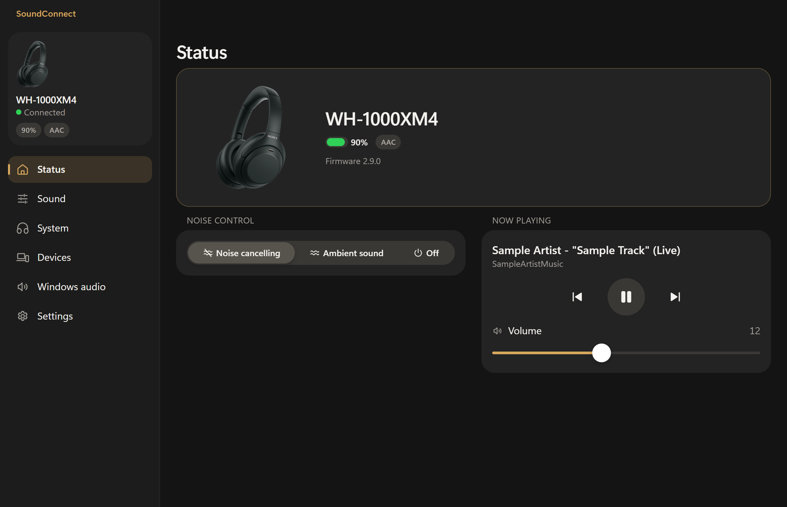
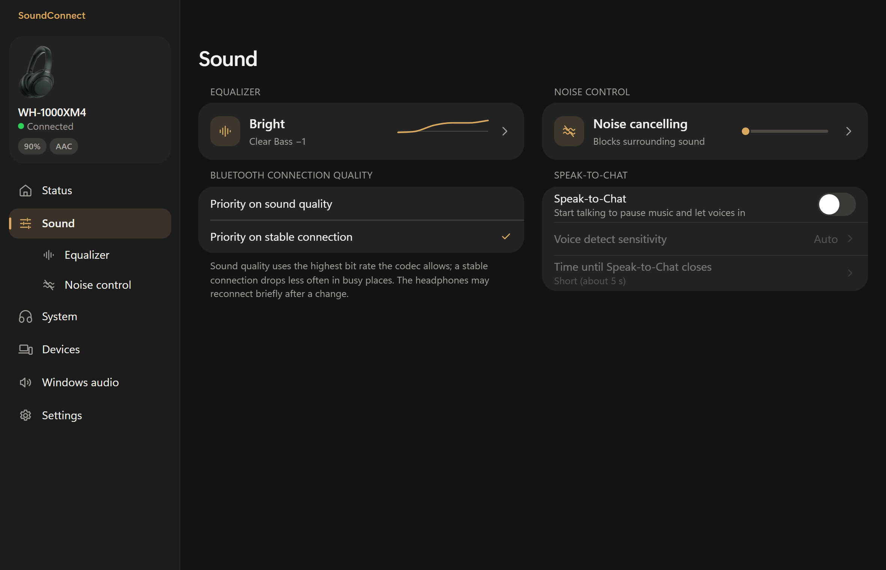
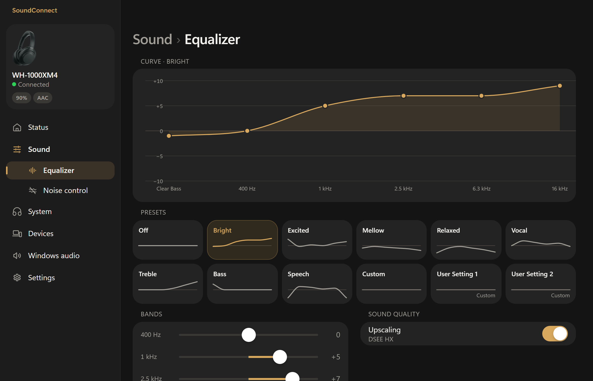
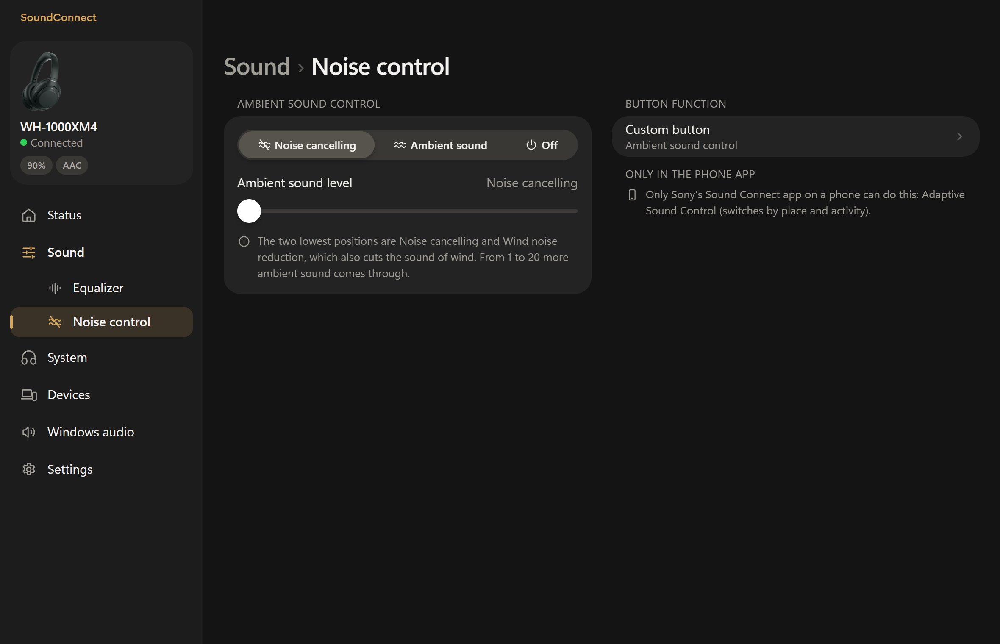
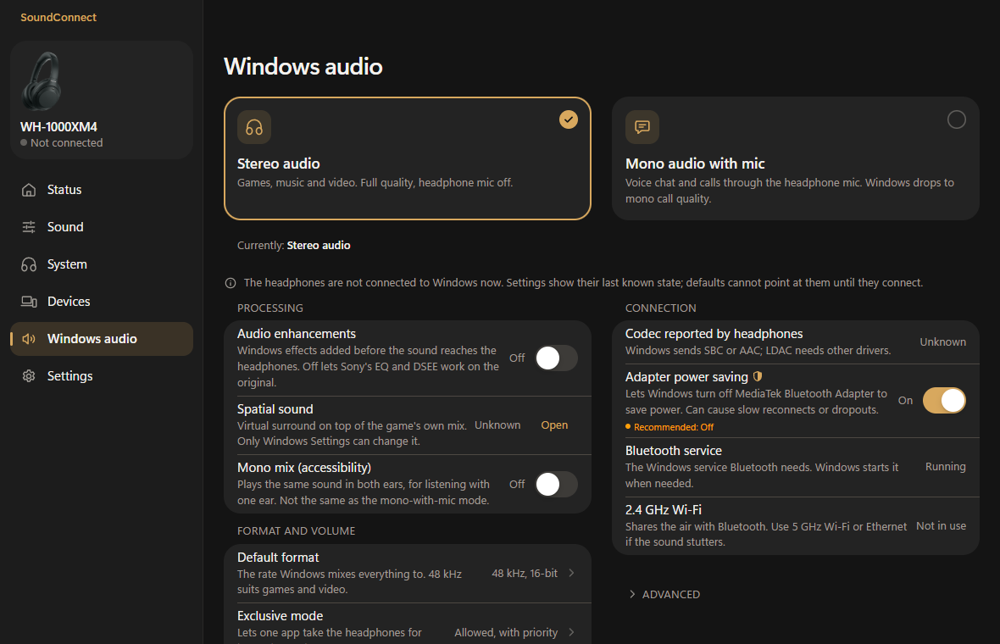

# SoundConnect Desktop

An unofficial Windows app for controlling Sony headphones from your PC: noise
cancelling and ambient sound, equalizer, battery, playback and device settings,
in a desktop interface modelled on Sony's Sound Connect phone app.

**Not affiliated with, endorsed by, or supported by Sony.**

### **[Download the latest installer](https://github.com/B-Howell/soundconnect-desktop/releases/latest/download/SoundConnect-Desktop-Setup.exe)** (Windows 10/11)

1. Download **SoundConnect-Desktop-Setup.exe** from the link above.
2. Run it. If Windows shows "Windows protected your PC", click **More info**,
   then **Run anyway** (the app is not code-signed). No admin prompt.
3. Open **SoundConnect Desktop** from the Start menu, pair your headphones in
   Windows Bluetooth settings if you have not, and follow the setup wizard.

From 0.1.9 on, the app updates itself from Settings.



> **Built with REA.** This project began as a test drive of
> [REA, Reverse Engineer Anything](https://github.com/morluto/rea). Before the
> protocol engine was adopted, REA inventoried and security-reviewed the
> upstream SonyHeadphonesClient binaries (PE resources, strings, provenance);
> that evidence lives in [`docs/research/`](docs/research/). It was a fun
> project to test REA on.

| | |
|---|---|
|  |  |
| **Sound**: equalizer, noise control, connection quality and Speak-to-Chat at a glance | **Equalizer**: presets with their recorded curves, five bands and Clear Bass, DSEE |
|  |  |
| **Noise control**: the 22-stop ambient sound slider and the custom button | **Windows audio**: choose stereo audio or mono audio with mic, and see how Windows treats the headphones |

## Why

Sony ships its headphone app for phones only. On a Windows PC you cannot switch
noise cancelling, change the EQ or see the battery without picking up your
phone. SoundConnect Desktop does that from the taskbar and the tray.

## Features

Grouped the way the app's left rail is:

- **Status**: model photo, battery, codec and firmware; quick noise control
  (Noise cancelling / Ambient sound / Off); now playing with play/pause,
  previous/next and headphone volume.
- **Sound**
  - **Equalizer**: Sony's presets drawn from the curves recorded on the
    device, five bands plus Clear Bass, custom and user presets, DSEE
    upscaling.
  - **Noise control**: ambient sound control the Sony way (one slider from
    noise cancelling through wind-noise reduction to 20 ambient levels) and
    the custom button's function.
  - Bluetooth connection quality (sound vs stable connection) and
    Speak-to-Chat with its sensitivity and timeout.
- **System**: touch sensor control panel, automatic pause when the
  headphones are taken off, auto power off, voice guidance, power off.
- **Devices**: multipoint, the list of paired devices, pairing a new device.
- **Windows audio**: one choice between "Stereo audio" (games, music,
  video; headphone mic off) and "Mono audio with mic" (voice chat through the
  headphone mic), previewed before anything changes; then how Windows
  processes and carries the sound (enhancements, format, exclusive mode,
  ducking, absolute volume, codec, adapter power saving), with restore. Admin-only changes are marked and run through
  an elevated helper.
- **Settings**: connect automatically, set up or forget headphones, theme,
  start with Windows (optionally minimized), keep running in the tray,
  updates (it updates itself from Settings, checking once a day), about and
  licences.
- **Tray**: name and battery in the tooltip, quick noise control without
  opening the window.

The app only sends a setting to the headphones when you change one, so it can
run alongside the Sony phone app (whichever changes a setting last wins).

## Supported headphones

The app talks to the headphones through
[mos9527/SonyHeadphonesClient](https://github.com/mos9527/SonyHeadphonesClient)'s
protocol engine (libmdr), so it supports the devices that engine supports. See
upstream's
[device-support list](https://github.com/mos9527/SonyHeadphonesClient/tree/main/docs/device-support):
WH-1000XM3, WH-1000XM5, WH-1000XM6, WH-CH720N, WF-1000XM5, WF-1000XM6,
WF-C510, WF-C700N, WF-L910, WF-LC900 and WF-LS900N, each with its own feature
notes. **The WH-1000XM4 (firmware 2.9.0) is the only device tested here**;
other models get the pages and controls their engine support reports.

Requirements: Windows 10 or 11 (x64), the WebView2 runtime (preinstalled on
Windows 11), and headphones paired and connected to the PC in Windows'
Bluetooth settings.

## Install

1. Download [SoundConnect-Desktop-Setup.exe](https://github.com/B-Howell/soundconnect-desktop/releases/latest/download/SoundConnect-Desktop-Setup.exe) (the newest release;
   every release also carries it as `SoundConnect.Desktop_<version>_x64-setup.exe`).
   `SHA256SUMS.txt` next to it lets you check the download
   (`Get-FileHash .\SoundConnect*.exe`).
2. Run it. The installer is **not code-signed**, so Windows SmartScreen shows
   "Windows protected your PC": choose **More info**, then **Run anyway**.
3. It installs for the current user only (no admin prompt) into
   `%LOCALAPPDATA%\SoundConnect Desktop` and adds a Start menu entry.
   Uninstall from Settings > Apps.
4. Later versions install from inside the app: a banner offers each new
   release (Install now, Later, Release notes), or use Settings > Updates >
   Check now. Updates are signed; the app refuses a download whose signature
   does not match.

The app does not search for headphones by itself unless you turn on
"Connect automatically"; it remembers the headphones you connected and shows
them as not connected until you press Connect.

## Build from source

Prerequisites: Windows x64, Node 24 and pnpm 10, Rust (stable, MSVC target),
Git, and either the GitHub CLI (`gh`, signed in) or Visual Studio 2022 with the
C++ workload and CMake 3.31+.

```powershell
git clone --recurse-submodules https://github.com/B-Howell/soundconnect-desktop
cd soundconnect-desktop
pnpm install

# The engine DLLs (mdr-shared.dll, mdr-bt-shared.dll) go in engine/bin/RelWithDebInfo.
./tools/fetch-engine.ps1     # download them from the "Engine DLLs" workflow run, or
./tools/build-engine.ps1     # build them locally from the pinned submodule (VS 2022)

pnpm dev                     # run the app (Tauri dev)
pnpm dev:web                 # the renderer alone in a browser; set VITE_MOCK_ENGINE=1 for the mock engine
pnpm dist                    # NSIS installer in src-tauri/target/release/bundle/nsis/
```

Tests:

```powershell
pnpm typecheck
pnpm test                                                   # Vitest
cargo test --manifest-path src-tauri/Cargo.toml --workspace # needs the engine DLLs
```

The Rust tests replay real, scrubbed device captures rather than hand-written
packets. See [CONTRIBUTING.md](CONTRIBUTING.md) before opening a pull request.

## How it works

SoundConnect Desktop does not implement Sony's protocol itself. A Tauri 2 app
(Rust core, React renderer) loads upstream's `libmdr` (the protocol state
machine) and `libmdr-bt` (the Windows RFCOMM transport) as DLLs built from a
pinned submodule commit. An engine thread in the Rust core owns the
connection, turns the engine's state into snapshots for the renderer, and
sends a command only when you change a setting. A separate crate reads and
changes Windows' own audio settings for the headphones. All of the design,
contracts and verification evidence starts at the
[Documentation Home](<docs/SoundConnect Desktop - Documentation Home.md>).

## Known limitations

- **WH-1000XM4 paired-device actions**: the list of paired devices is
  read-only on the XM4 (protocol V1); the engine refuses connect, disconnect
  and unpair for it.
- **Speak-to-Chat preview frame**: the XM4 sends a Speak-to-Chat preview
  notify that upstream libmdr cannot parse. The app skips that frame instead
  of dropping the link; the upstream fix is still open (see
  [the issue draft](docs/research/upstream-issue-speak-to-chat-preview.md)).
- **360 Reality Audio** setup is phone-only (it needs Sony's ear analysis)
  and is not offered here.
- Only the WH-1000XM4 has been tested with real hardware; other models rely
  on upstream's engine support.
- The installer is unsigned (SmartScreen warns once).

## Credits

- **[mos9527](https://github.com/mos9527) and the
  [SonyHeadphonesClient](https://github.com/mos9527/SonyHeadphonesClient)
  contributors** (including [Amrsatrio](https://github.com/Amrsatrio)): the
  MIT-licensed `libmdr` / `libmdr-bt` protocol engine this app loads as DLLs.
  Their recorded device captures are this project's test fixtures. This app
  would not exist without their reverse engineering.
- **[Plutoberth](https://github.com/Plutoberth)**: the original
  [SonyHeadphonesClient](https://github.com/Plutoberth/SonyHeadphonesClient),
  which started the open reverse engineering of Sony's headphone protocol.
- **[Andreas Olofsson's libmdr](https://github.com/AndreasOlofsson/libmdr)**:
  upstream credits its `libmdr` naming to this earlier project.
- **[REA, Reverse Engineer Anything](https://github.com/morluto/rea)**: this
  project began as a test drive of REA. REA inventoried and security-reviewed
  the upstream binaries (PE resources, strings, provenance) before the engine
  was adopted; [`docs/research/`](docs/research/) holds that evidence.
- **Sony** product photos are © Sony and are shown only to identify the
  headphones you have connected.

## License

MIT, see [LICENSE](LICENSE). The installer's licence page and the app's
Settings > Licences sheet also carry upstream SonyHeadphonesClient's MIT
licence for the bundled engine DLLs.

## Not affiliated with Sony

SoundConnect Desktop is an independent project. It is not affiliated with,
endorsed by, or supported by Sony. "Sony", "Sound Connect" and the product
names are Sony's trademarks. The product images shown in the app are Sony's
copyright and are used only to identify the headphones you have connected.
